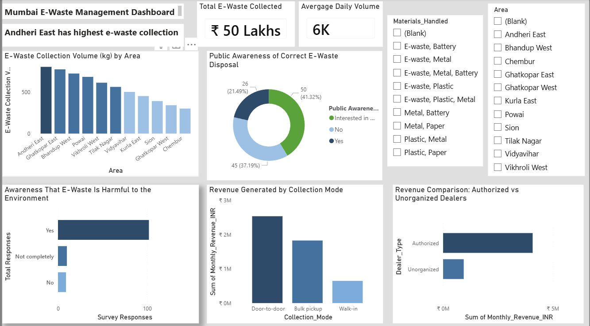

# 📊 E-Waste Management Dashboard (Power BI)

## 🔍 Overview  
Developed an interactive Power BI dashboard for analyzing e-waste generation, tracking KPIs, and identifying trends to support data-driven decision-making and MIS reporting.

## 🎯 Objectives  
- Track e-waste generation over time  
- Monitor recycling and disposal trends  
- Identify high-contributing categories  
- Support environmental decision-making  

## 🛠️ Tools Used  
- Power BI  
- Advanced Excel  
- Power Query  

## 📈 Key Features  
- KPI tracking (Total E-Waste, Recycling Rate)  
- Interactive filters (Year, Category, Region)  
- Trend analysis and comparisons  

## 💡 Key Insights  
- E-waste generation shows an increasing trend  
- Certain categories contribute more to total waste  
- Recycling rates vary across regions  

## 📷 Dashboard Preview  

